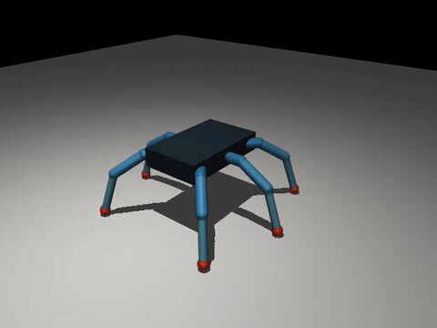

# Alfred Hexapod Lab — цифровой прототип Freenove FNK0052

Исследовательский проект Альфреда: моделирование шестиногой ходьбы насекомых и экспериментальное сравнение контроллеров. **Никакой автономный ИИ на роботе не требуется.** Альфред организует эксперименты, модель рассчитывает динамику, низкоуровневый контроллер позже будет управлять приводами.

## v0.4 — восстановление физической конструкции (в работе)

**Статус модели:** прежняя v0.3 — диагностический набросок, не точный цифровой двойник Freenove FNK0052. В v0.4 запрещено считать условную массу корпуса/ног, реальные положения осей, момент сервоприводов или инерции установленными фактами.

- [Реконструкция: источники, геометрия, массы, критерии допуска](docs/PHYSICAL_MODEL_V04.md)
- [Параметрический реестр с provenance и неизвестными массами](data/fnk0052_v04_manifest.json)
- [Issue #3: восстановление физической конструкции](https://github.com/Dmitry-dev-pet/alfred-hexapod-lab/issues/3)
- Проверка готовности: `python -m hexlab.physical_v04`. Пока вернёт `ready_for_physics_comparison: false` — это правильно.

Достоверно из кода производителя: эффективные длины звеньев 33/90/110 мм и некоторые кинематические опорные точки. **Не установлены:** точные геометрические формы/оси узлов, реальные массы и тензоры инерции, версия серв, фактические характеристики под нагрузкой. Сохраняем две будущие комплектации `stock_pi` и `proposed_esp32`; ни одна из них не взвешена. Сначала изучаем физику конструкции, затем сравниваем биомеханические алгоритмы походки.

## Просмотр физической симуляции



[Открыть MP4](results/first_tripod_demo.mp4) · [Открыть GIF](results/first_tripod_demo.gif)

Первая демонстрация: **6 секунд реальной динамики MuJoCo, 18 приводов**.
В пробном режиме робот почти не перемещается; это **диагностическая запись**, а не найденная эффективная походка.

Для повторного рендеринга на Linux с Xvfb, FFmpeg и установленным MuJoCo:

```bash
xvfb-run -a python scripts/render_video.py --seconds 6 --fps 15
```

При обновлении файла `.github/workflows/render-demo.yml` или ручном запуске workflow [Render Hexapod demo GIF and MP4](../../actions/workflows/render-demo.yml)
GitHub Actions создаёт анимации и сохраняет их в `results/` для просмотра прямо на странице проекта.

## Состояние на 2026-11-03

- **Работает:** Python-пилот геометрической устойчивости с фиксированной tripod-походкой и простыми локальными правилами, геометрия звеньев 33/90/110 мм по исходникам Freenove.
- **Работает:** приблизительная модель MuJoCo 3.14.0 с 18 вращательными суставами, контактом ног с поверхностью, позиционными приводами и лимитами моментов. Проверена загрузка модели, симуляция и headless-рендеринг.
- **Испытано:** стойка 2 секунды (1000 шагов), tripod 10 секунд (5000 шагов). Смещение корпуса в пробном tripod-режиме — лишь 5,35 мм. **Эффективная походка пока не получена.**
- **Тесты:** 12/12 проходят командой `python -m unittest discover -s tests -v`.
- **Не сделано:** полноценный neuroWalknet; калибровка масс, моментов, трения и датчиков; соединение с реальным Freenove/ESP32.

## Установка и запуск

Нужен Python 3.13 и MuJoCo 3.14.0 (либо совместимый Python с соответствующим wheelhouse). Без MuJoCo базовый геометрический пилот работает с Python 3.10+.

```bash
python -m unittest discover -s tests -v
python -m hexlab.run_experiment
python -m hexlab.mujoco_model
python -m hexlab.mujoco_experiment --mode stand --seconds 2
python -m hexlab.mujoco_experiment --mode tripod --seconds 10
```

Для установки из заранее собранного wheelhouse без сети:

```bash
python3.13 -m venv .venv
.venv/bin/python -m pip install --no-index --find-links /path/to/wheelhouse -r runtime/requirements.txt
```

Валидация бинарного пакета — в `runtime/STATUS.md`. CI-sборка: [GitHub Actions run #41674000645](https://github.com/Dmitry-dev-pet/truthrail/actions/runs/41674000645). Бинарные зависимости хранятся отдельно от исходников в Google Drive / Alfred-Runtime-Bundles.

## Научная корректность

**Геометрический пилот** сравнивает фиксированную tripod-походку с контроллером, который явно проверяет опорный многоугольник. Его преимущество при отказе ноги — ожидаемый результат алгоритма, **не доказательство** преимуществ биологического управления. Скорость корпуса в пилоте задана извне.

**MuJoCo-модель** пока приближённая: по фактическому Freenove неизвестны массы звеньев, моменты инерции, параметры MG996R, упругость и трение; конструктор записывает предположения в XML. Хорошая симуляция не доказывает хорошую ходьбу реального робота.

**neuroWalknet** ещё не импортирован. Исходная исследовательская реализация GPL-3.0 использует симулятор Hector/ODE. Перенос нейронного контроллера в MuJoCo потребует отдельного адаптера и соблюдения лицензии.

## Источники и лицензирование

- [Freenove FNK0052](https://github.com/Freenove/Freenove_Big_Hexapod_Robot_Kit_for_Raspberry_Pi) — геометрия и ориентиры кинематики; проект Freenove CC BY-NC-SA 3.0. Наш исходный код написан самостоятельно, исходные файлы Freenove не копируются.
- [neuroWalknet](https://github.com/hcruse/neuro_walknet) — научная реализация распределённого управления (GPL-3.0), не включена в репозиторий.
- [MuJoCo](https://github.com/google-deepmind/mujoco) — библиотека физического моделирования.

## Дальнейшие эксперименты

**Перед строгим сравнением походок:** выполнить физическую реконструкцию v0.4 из Issue #3. Пилот v0.3 остаётся допустим только как диагностическая демонстрация.

1. Добиться измеримого поступательного движения в MuJoCo и валидировать координаты ног, контакт и моторные ограничения.
2. Сравнить неизменную tripod-походку с локальной координацией ног на ровной, наклонной и скользкой поверхности.
3. Испытать изменение скорости и потерю одной ноги, фиксируя скорость, долю падений, проскальзывание, силы контактов и момент приводов.
4. Добавить биологически обоснованные правила Cruse и отдельно проверить полноценный neuroWalknet.
5. После покупки робота — установить ESP32 и сравнить физические измерения с симуляцией.

Исходники и рецепты должны жить в GitHub; тяжёлые бинарные пакеты и изображения можно хранить в Google Drive с хешами и воспроизводимыми манифестами.